<div align="center">

<picture>
  <source media="(prefers-color-scheme: dark)" srcset="assets/ship-pipeline-dark.svg" />
  <source media="(prefers-color-scheme: light)" srcset="assets/ship-pipeline-light.svg" />
  
</picture>

<br/>


</div>

---

## 📦 package.json

```json
{
  "name": "ahmed-naveed",
  "version": "2.0.0-fullstack",
  "description": "Full Stack Developer who turns Figma designs into fast, responsive websites and web apps",
  "author": "Ahmed Naveed <ahmedmalik2644475@gmail.com>",
  "location": "Karachi, Pakistan",
  "currentlyAt": "Techelix",
  "scripts": {
    "design":   "figma --to wordpress --pixel-perfect",
    "store":    "woocommerce --setup --products --payments",
    "build":    "node express.js && mongoose connect",
    "frontend": "react + next.js + tailwind",
    "optimize": "lighthouse --core-web-vitals --seo",
    "ship":     "deploy --from local --to live"
  },
  "dependencies": {
    "wordpress": "custom themes, child themes, plugins",
    "php": "themes & plugins", "mysql": "wordpress db",
    "node": "express, ejs", "mongodb": "mongoose",
    "react": "next.js", "css": "tailwind, bootstrap"
  },
  "keywords": ["full-stack", "wordpress", "woocommerce", "mern", "figma-to-code", "performance"]
}
```

---

## 🧩 dependencies

<p align="center">
  <br/>
  <br/>
  
</p>

| Layer | What I use |
|---|---|
| **CMS** | WordPress: custom themes & child themes, custom plugins, Elementor, WPBakery |
| **E-commerce** | WooCommerce setup and customization: products, checkout, payment integration |
| **Frontend** | HTML5, CSS3, JavaScript, React, Next.js, Tailwind CSS, Bootstrap, mobile-first responsive design |
| **Backend** | PHP, Node.js, Express, EJS templating, REST routes, CRUD apps |
| **Database** | MySQL, MongoDB (Mongoose) |
| **Design → code** | Figma to WordPress / React conversion |
| **Performance & SEO** | Speed optimization, Core Web Vitals, on-page & technical SEO basics |
| **Shipping** | Local → live migration & deployment, Git/GitHub, debugging & bug fixing |

---

## 📜 CHANGELOG

> Experience, newest release first.

### `v2.0.0` · Full Stack · *in progress*
- ✨ Added the JavaScript stack: **Node.js + Express + MongoDB**, plus **React / Next.js** on the frontend
- ✨ Building CRUD apps and dashboards beyond WordPress (see repos below)

### `v1.2.0` · WordPress Developer @ **Techelix** · *Oct 2025 – present*
- 🚀 Develop and customize client websites with themes, plugins and **Elementor**
- 🛒 Set up and manage **WooCommerce** stores
- ⚡ Website optimization, performance improvements and bug fixes on real client projects
- 🔁 Learned team deployment workflows

### `v1.1.0` · Web Development Intern @ **SED Pvt** · *Mar 2024 – May 2025*
- 🧱 Core HTML, CSS and JavaScript; static pages and responsive design
- 🛠️ Content updates, UI improvements and day-to-day dev & testing

### `v1.0.0` · Freelance WordPress Developer · *Jan 2024 – Feb 2025*
- 🎨 Converted **Figma** and reference designs into responsive WordPress sites for small clients
- 🛒 Built WooCommerce stores with product listings and payment integration
- 📈 Improved site speed, performance and SEO, and handled client requirements & revisions

---

## 📁 Repositories

| Repo | What it is | Stack |
|---|---|---|
| [**CRUD**](https://github.com/ahmedmalik2644475-a/CRUD) | Full create / read / update / delete app with a database | Node.js · Express · MongoDB · EJS |
| [**Task-Board**](https://github.com/ahmedmalik2644475-a/Task-Board) | Task board web app | Node.js · Express · EJS |
| [**My-Portfolio**](https://github.com/ahmedmalik2644475-a/My-Portfolio) | Personal portfolio site | HTML · CSS · JavaScript |

---

## 🐛 Known issues

- `WARN` Will check the mobile view before you've finished saying "looks good on desktop".
- `WARN` Can't see a 2 MB hero image without compressing it.
- `INFO` Treats "can you make it pixel-perfect to the Figma?" as a personal challenge.

---

## 🤝 Contributing (hire me)

**Open to:** 💼 full-time Full Stack / WordPress roles · 🧑‍💻 freelance projects: WordPress & WooCommerce sites, Figma-to-code, web apps.

<p align="center">
  <a href="mailto:ahmedmalik2644475@gmail.com"></a>
  <a href="https://www.linkedin.com/in/ahmed-naveed-dev"></a>
</p>

```bash
$ npm install ahmed-naveed --save
added 1 developer, 0 vulnerabilities ✔
```

<div align="center">
<sub>⚡ built with WordPress, Node and too much coffee · last deployed October 2026</sub>
</div>
